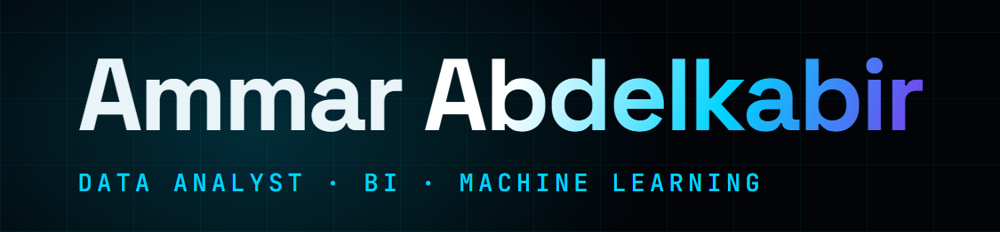

  <!-- Logo / Banner -->
  

  <h1>Ammar Abdelkabir — Data Analyst & Data Science</h1>
  
<em>Turning raw data into decisions.</em>

  <!-- Badges -->
  
  
  
  

   

  <!-- Links -->
  <h3>
    <a href="https://ammar-abdalkber.vercel.app">Live Portfolio</a> • 
    <a href="https://www.linkedin.com/in/ammarabdalkber">LinkedIn</a> • 
    <a href="https://github.com/3mmar3bdalkber">Main GitHub</a>
  </h3>

---

## About The Project
This is my personal portfolio website built to showcase my expertise in **Data Analysis, Business Intelligence, and Machine Learning**. It features a fully responsive design with a futuristic, 3D neon aesthetic.

### Key Features
* **3D Interactive Background:** Built with `Three.js` (particles, geometric rings, and a moving neon grid).
* **Dynamic Projects Archive:** A filterable, searchable grid of my data projects with auto-playing image carousels.
* **Glassmorphism UI:** Modern, sleek UI with cursor spotlight effects and smooth scrolling animations.
* **Fully Responsive:** Optimized for mobile, tablet, and desktop viewing.
* **Contact Form:** Integrated with Web3Forms for direct email functionality.

---

## Tech Stack
* **Frontend:** Vanilla HTML5, CSS3, JavaScript (ES6)
* **3D Engine:** [Three.js](https://threejs.org/)
* **Fonts:** Space Grotesk, JetBrains Mono, Inter
* **Icons:** Custom SVG & CSS
* **Deployment:** GitHub Pages / Vercel

---

## Projects Highlighted
1. **Global Asthma Burden Analysis** — SQL Server, Power BI, Tableau, Python, XGBoost.
2. **Bank Marketing Analysis** — Excel, DAX, Power Query.
3. **Data Warehousing** — Building normalized schemas and ETL pipelines.

---

  
Made with 💙 and way too much Tea by <strong>Ammar Abdelkabir</strong>

